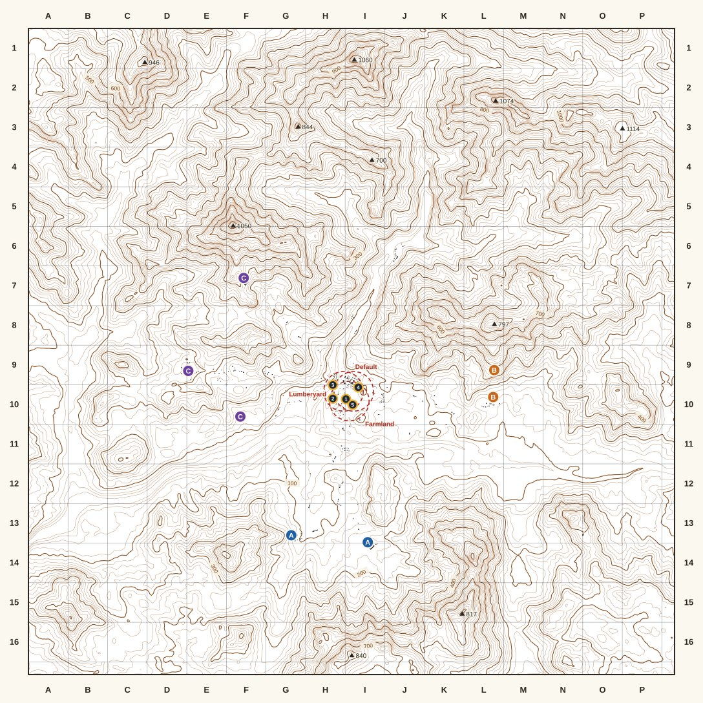
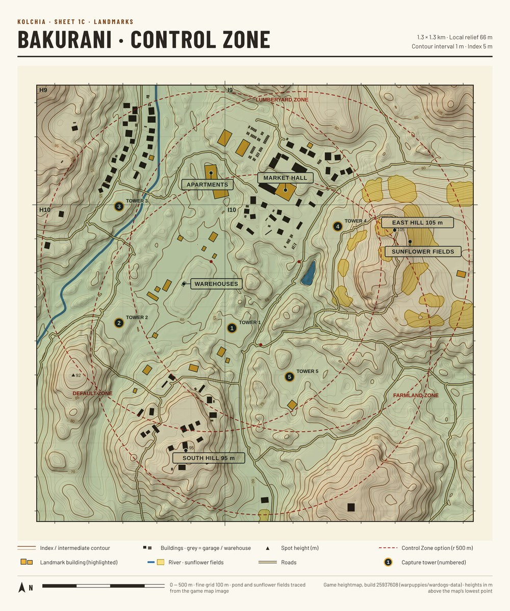
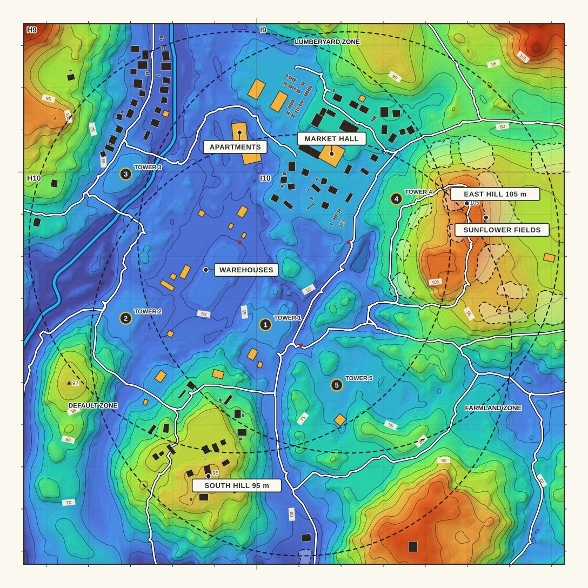
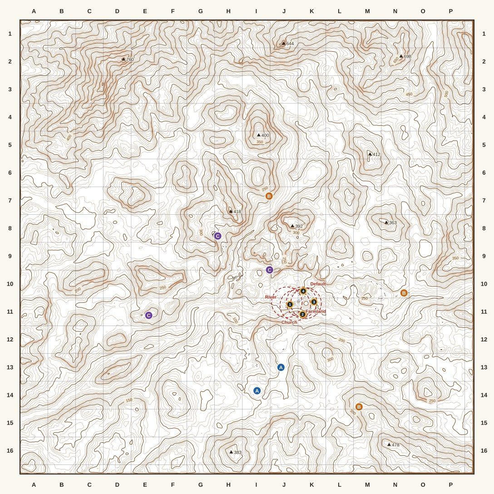
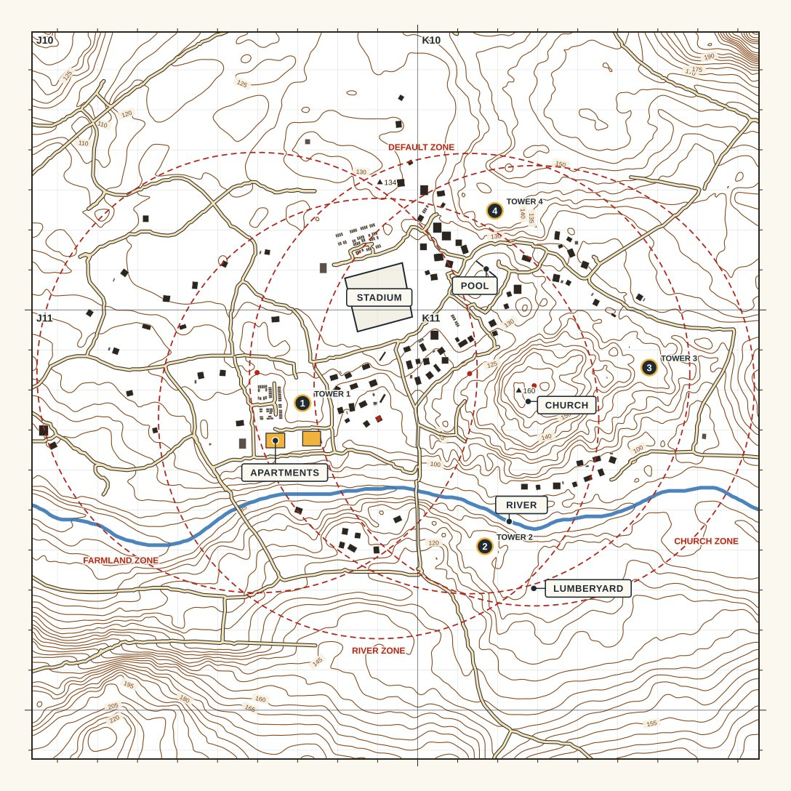
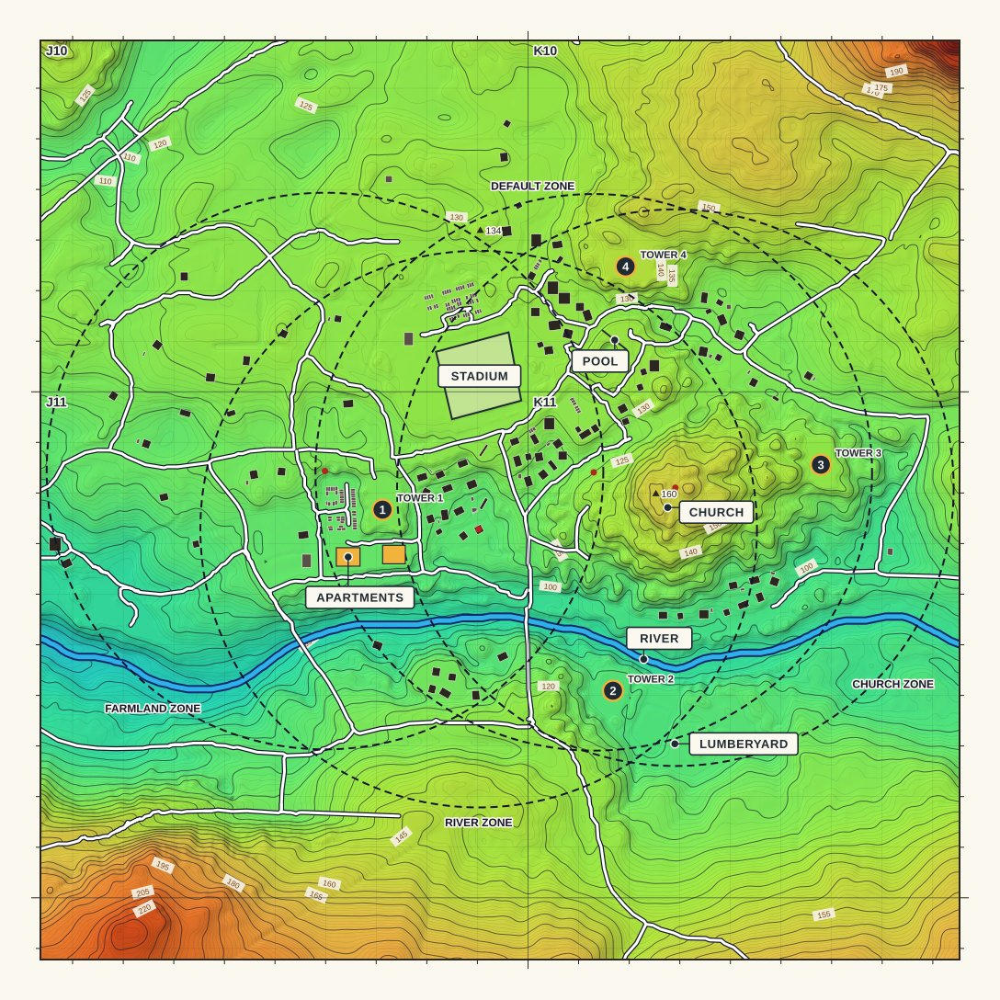
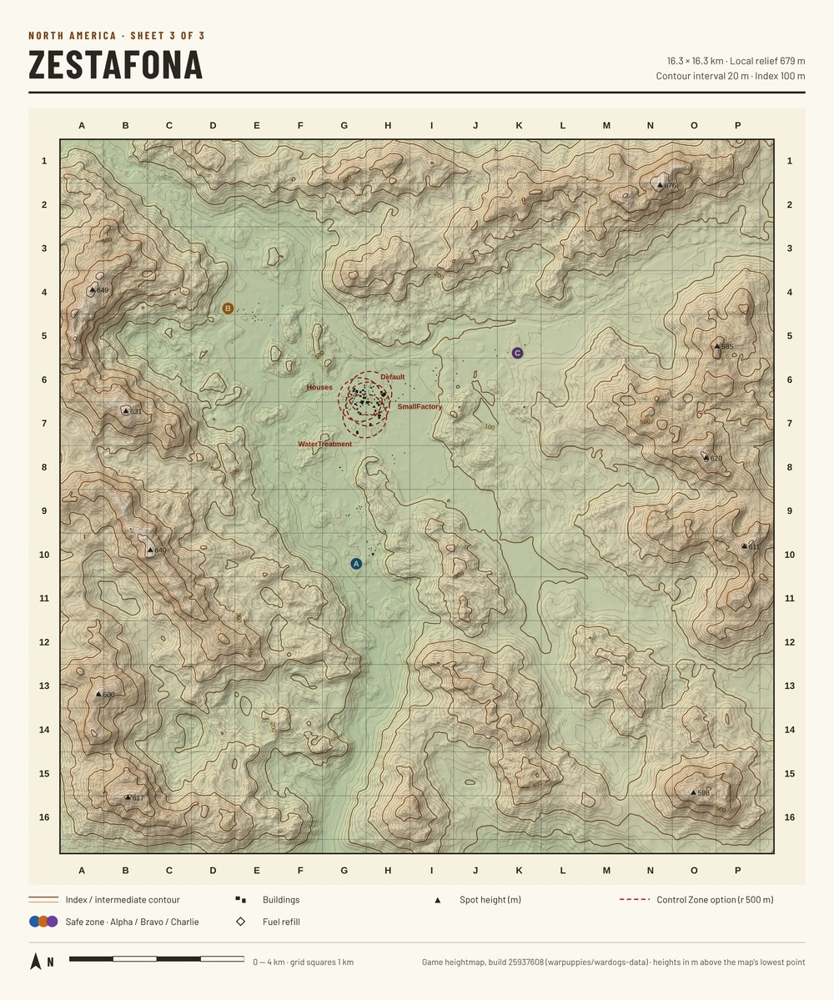
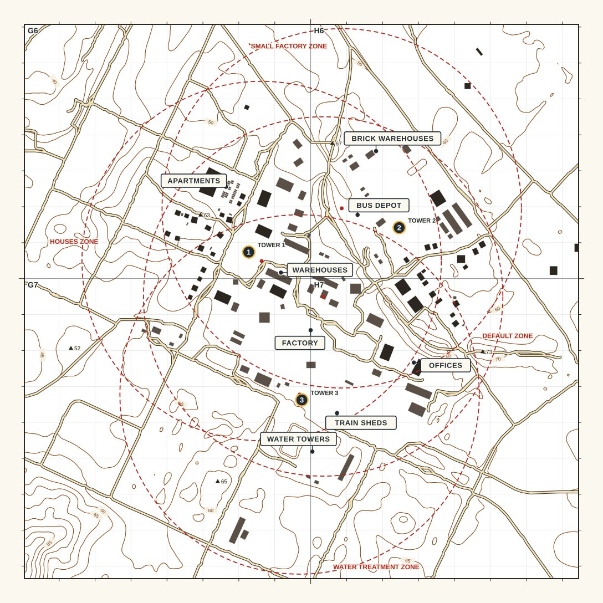
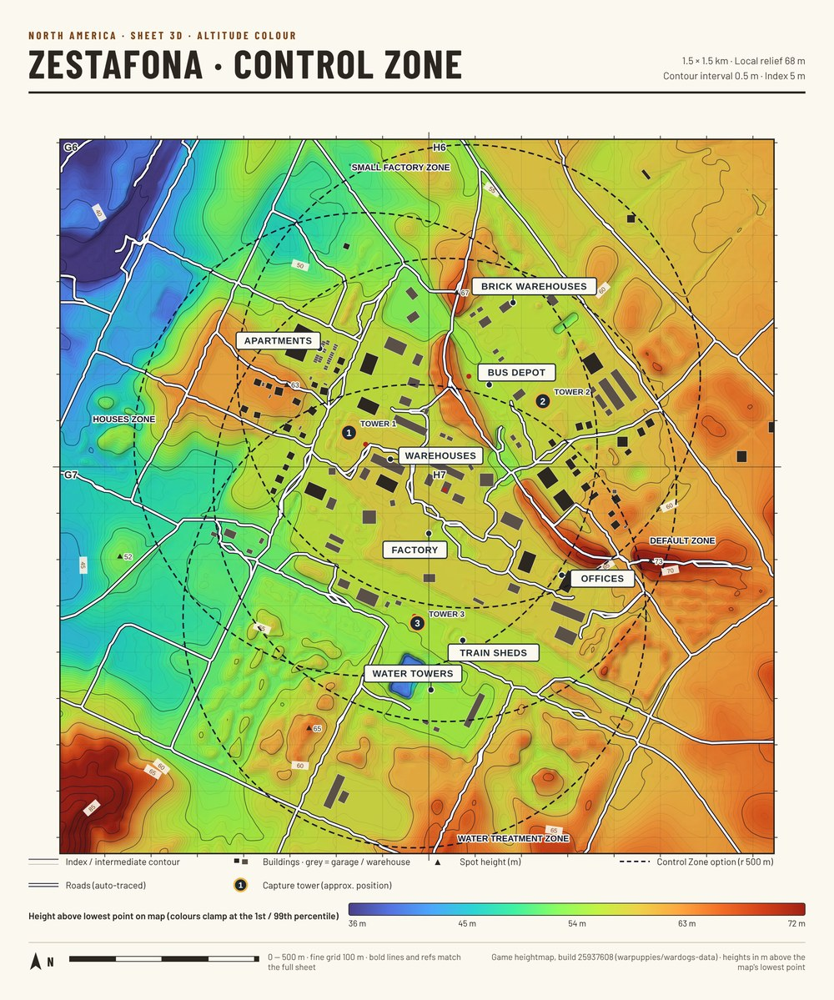

# WARDOGS Topographical Maps

Topographic-style maps of the WARDOGS game maps, built from the game's real 16-bit heightmaps rather than the blurry overview images.
Three maps are covered: **Bakurani** (`kavkazi`), **Ozeti** (`europe`) and **Zestafona** (`north-america`).

| | Full map | Landmarks close-up (roads, river, towers, labels) | Altitude colour |
|---|---|---|---|
| Bakurani |  |  |  |
| Ozeti |  |  |  |
| Zestafona |  |  |  |

## Ready-to-use PNG exports
Full sheets (title, map, legend, scale bar), 2336 x 2800 px, in [`exports/`](exports/). Click a link to open or right-click to save.

| Sheet | Bakurani | Ozeti | Zestafona |
|---|---|---|---|
| Full map | [PNG](exports/Bakurani_full-map.png) | [PNG](exports/Ozeti_full-map.png) | [PNG](exports/Zestafona_full-map.png) |
| A: Control Zone close-up, 2 m contours | [PNG](exports/Bakurani_1A_control-zone-2m.png) | [PNG](exports/Ozeti_2A_control-zone-2m.png) | n/a |
| B: fine contours (1 m; 0.5 m on Zestafona) | [PNG](exports/Bakurani_1B_contours-1m.png) | [PNG](exports/Ozeti_2B_contours-1m.png) | [PNG](exports/Zestafona_3B_contours-0.5m.png) |
| C: landmarks, roads, towers | [PNG](exports/Bakurani_1C_landmarks.png) | [PNG](exports/Ozeti_2C_landmarks.png) | [PNG](exports/Zestafona_3C_landmarks.png) |
| D: altitude colour | [PNG](exports/Bakurani_1D_altitude-colour.png) | [PNG](exports/Ozeti_2D_altitude-colour.png) | [PNG](exports/Zestafona_3D_altitude-colour.png) |

They are rendered from the board sources with `scripts/export_png.py`. If you need vector, use the SVG overlays in `output/`.

## Sheets
Each map has a family of 1168 x 1400 design boards (sources in `sheets/`, a Design canvas with `canvas.json` holding the layout):

- **A** close-up of the Control Zone area with 2 m contours (Bakurani, Ozeti)
- **B** the same window with fine contours (1 m, or 0.5 m on Zestafona, whose terrain is very flat); contours, buildings, zone circles and towers only
- **C** landmarks sheet: roads, river/pond, labelled landmarks, capture towers
- **D** altitude colour: each window's colour ramp is stretched to its own lowest and highest ground, so even flat areas show contrast
- plus a full-map sheet per map (20 m contours on Bakurani, 10 m on Ozeti and Zestafona)

Heights are metres above the map's real lowest ground. Buildings are drawn at their real rotation (see METHOD).

## What is in this repo
- `scripts/`  the Python generators and helpers (see below)
- `data/`  hand-made and derived inputs: landmark/road/river configuration (`review_cfg.json`), tower positions, measured building angles, traced roads, mosaic and image-offset metadata
- `exports/`  the finished sheets as PNG images (linked above)
- `output/`  the generated relief images and SVG overlays used by the sheets
- `sheets/`  the board sources (`*.dc.html`) and `canvas.json`. Image references there (`/_blob/<id>`) point at assets stored in the original published canvas; the matching files are in `output/`
- `docs/METHOD.md`  how the maps are made, step by step, including the known limits

Source data is **not** included: it comes from https://github.com/warpuppies/wardogs-data (map JSON in `data/maps/<world>/`, and the release assets `assets/maps/<world>/{heightmap.png, tiles/}`).

## Quick start
```bash
pip install numpy scipy scikit-image matplotlib pillow     # plus rsvg-convert (librsvg) for previews
mkdir work && cp data/*.json work/
git clone https://github.com/warpuppies/wardogs-data work/repo/wardogs-data
python scripts/prep.py work <release>/assets/maps kavkazi europe north-america   # heightmap .npy + satellite mosaics
python scripts/orient_all.py work      # measures building angles (-> work/orient.json); NA angles come from data/orient_na.json
python scripts/real.py work            # full maps (Bakurani, Ozeti)            -> work/real/
python scripts/real_zest.py work       # full map (Zestafona)
python scripts/cz.py work              # close-ups A / B                        -> work/cz/
python scripts/cz3.py work             # landmarks sheets (C)
python scripts/mk4.py work && python scripts/cz4.py work    # altitude colour (D)
python scripts/cz5.py work && python scripts/cz5c.py work   # Zestafona C and D
```
Each script writes `<world>-<tag>-relief.webp`, `-minor.svg` (fine contours) and `-overlay.svg`; the sheets stack relief, minor and overlay.
See METHOD.md for the order and for how roads, towers and landmarks were produced.
